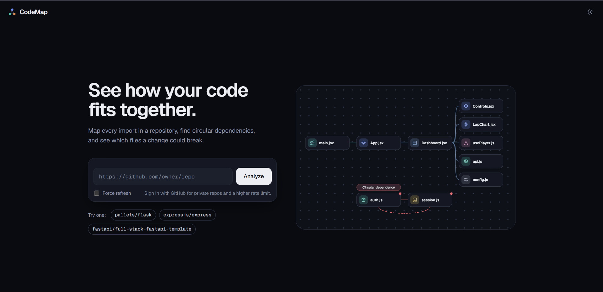
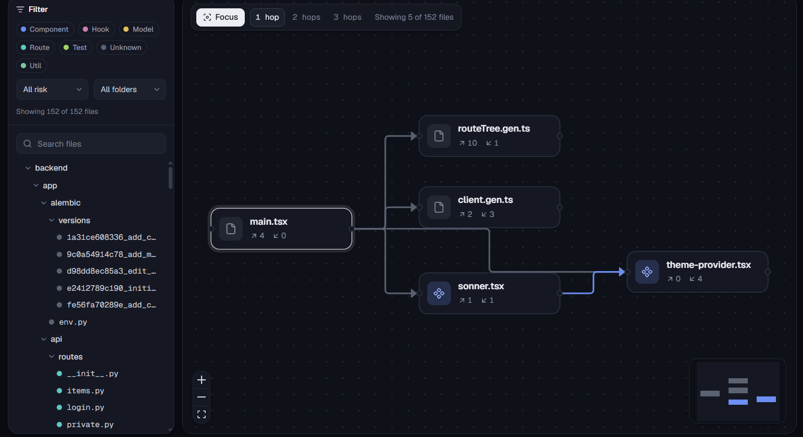
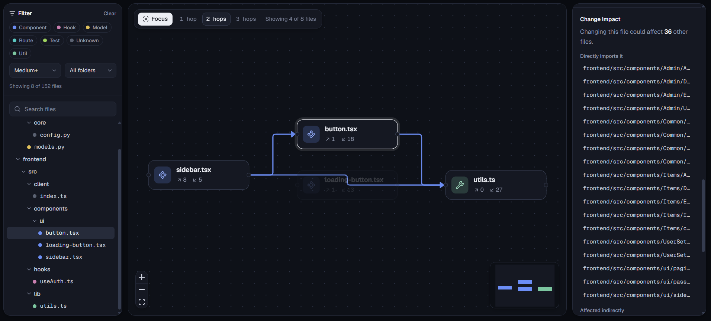
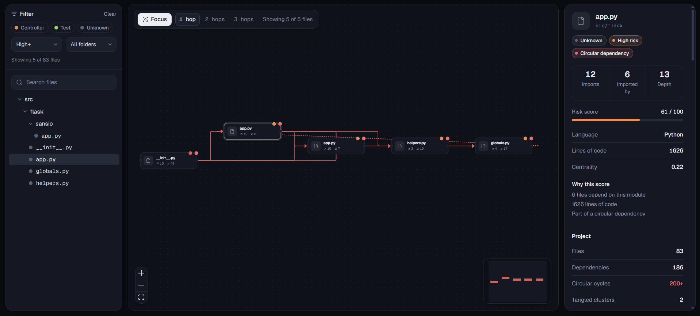
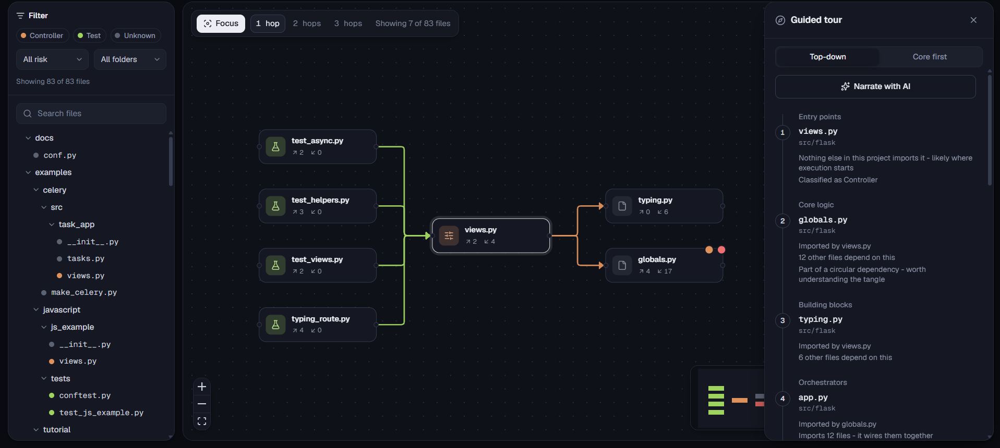
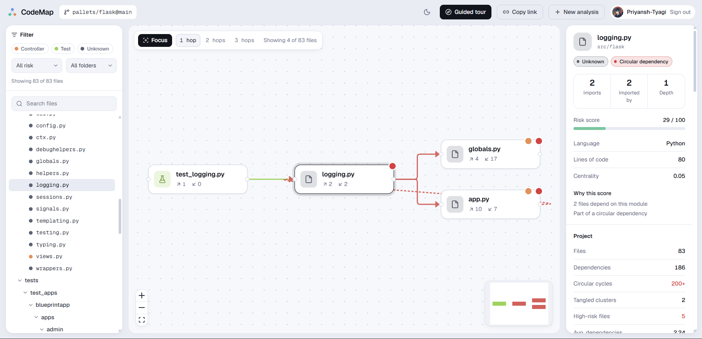
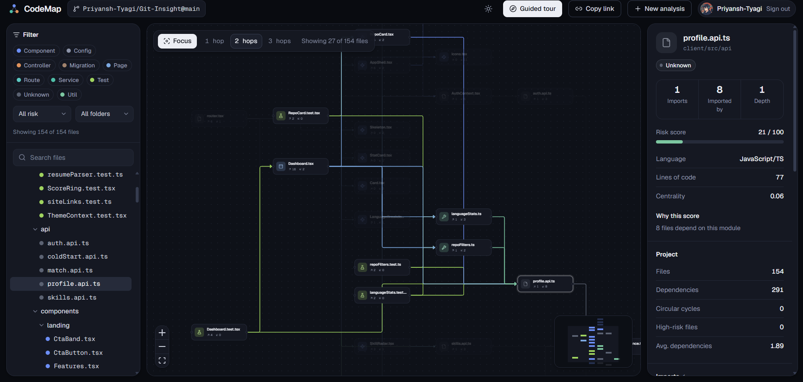
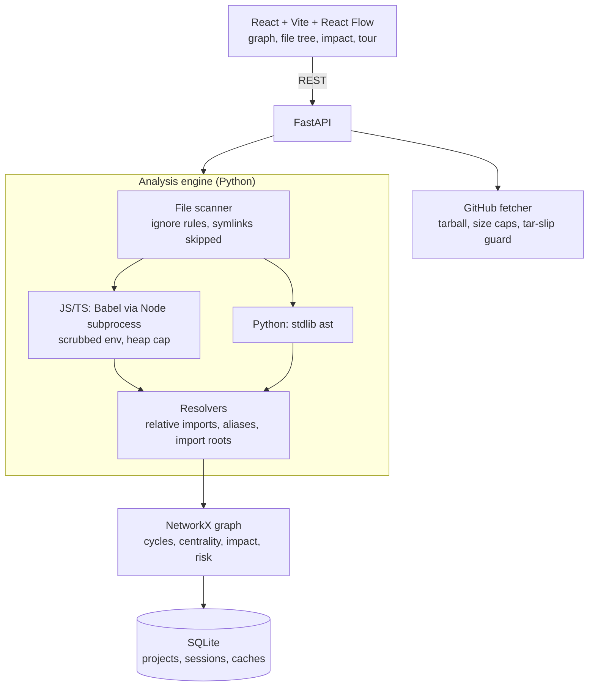
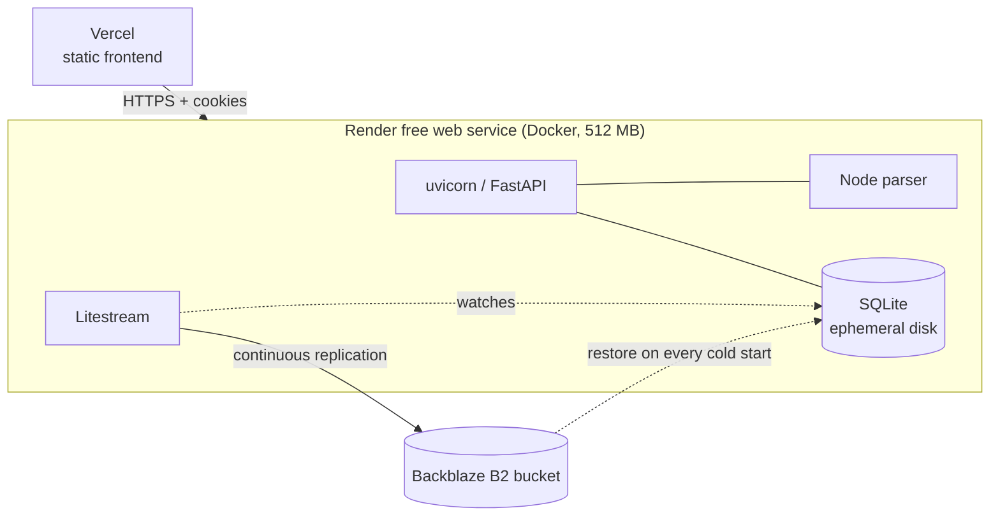

# CodeMap

[](https://github.com/Priyansh-Tyagi/Codemap/actions/workflows/tests.yml)

**See how a codebase fits together before you change it.**

CodeMap maps every import in a JavaScript, TypeScript or Python repository into an interactive dependency graph. It finds circular dependencies, shows what a change could break, scores each file's risk from the graph itself, and walks you through an unfamiliar repo in a sensible reading order. Paste a public GitHub URL (or sign in to analyze your own private repos) and get results in seconds. It also runs as a CLI and a GitHub Action that fails a pull request when it introduces a new cycle.

**Live demo:** https://codemap-gold.vercel.app  
*The backend runs on a free tier that sleeps when idle, so the first request after a quiet period can take about a minute to wake. After that it is fast.*

<<<<<<< HEAD

=======

>>>>>>> 8923defffb93397ab95c77583d24106744012783

---

## What it does

- **Dependency graph** for JS/JSX/TS/TSX and Python, merged into one NetworkX graph. Babel parses JS/TS (in a Node subprocess); Python uses the stdlib `ast`. The two languages go through separate resolvers, and a `.py` and a `.js` file that share a base name can never link (tested).
- **Circular-dependency detection** with the cycle-closing edge drawn distinctly. Cycle *membership* is exact (strongly connected components); listed cycles are capped at 200, shortest first, so a tangled repo stays readable.
- **Change-impact analysis**: what breaks if I touch this file, split into direct and indirect dependents.
- **Deterministic 0-100 risk score** per file (dependents, centrality, complexity, cycle membership) with plain-language reasons. No black box and no AI.
- **Focus mode**: a 150-file graph drawn at once is unreadable, and dimming doesn't help because dimmed nodes still take layout space. Focus mode draws only the selected file and the files 1-3 import-steps away, composes with the filters, and opens large projects already focused on the guided tour's first entry point. On the FastAPI full-stack template that is **5 files instead of 152**.
- **Guided tour**: a reading order computed from graph structure (top-down from entry points, or core-first). An optional "Narrate with AI" button adds a one-line explanation per stop and always falls back to the deterministic tour.
- **Path-alias resolution**: `@/lib/utils`-style imports (tsconfig `paths`/`baseUrl`/`extends`, Vite `resolve.alias`) become real edges instead of being miscounted as npm packages. Config files are read, never executed. On the FastAPI template this took the graph from 162 to 365 edges; on shadcn's Taxonomy from 0 to 259.
- **Architecture classification** (Component, Service, Route, Test, Util, Hook, plus Django/Flask conventions) and filtering by category, risk level or folder.
- **Shareable permanent links** (`/p/<id>`) backed by SQLite. Private-repo projects are visible only to the session that created them (a 404, never a 403, so existence isn't leaked).
- **Sign in with GitHub** (optional): your own 5,000/hour API quota and access to your private repos.
- **Honest about free hosting**: a sleeping server is woken the moment the page opens, with a "Waking the server" message and a timer instead of a frozen page, and an Analyze click made during the wake-up is held and starts by itself when the server answers (seen live: it used to fail with a developer-only error); and if backup storage is offline, a banner says so and the share-link button warns that the link may not last.
- **Light and dark themes**, file tree with search, imports/symbols panel.

### Screenshots

| | |
|---|---|
|  |  |
| **Focus mode** on the FastAPI full-stack template: 5 of 152 files | **Risk score and change impact** for a selected file |
|  |  |
| **A circular dependency**, with the cycle-closing edge drawn distinctly | **Guided tour**: a deterministic reading order |
|  |  |
| **Light theme** (dark is the default on dark-mode systems) | **Project stats** and architecture breakdown |

---

## Architecture



**Design decisions worth knowing**

- **SQLite, not Postgres.** One process and almost no concurrent writes; each project is one row of JSON. Storage sits behind a small functional interface (`services/store.py`), so the swap from an in-memory dict to SQLite changed zero API routes.
- **GitHub OAuth, not username/password.** It buys the two things users actually want (private repos and their own rate limit) with no password storage.
- **No caching of local-path analyses or alias configs.** A silently stale result is a correctness bug, not a missed optimization. GitHub results *are* cached (a ref is a stable target).
- **The AI layer is strictly optional.** The deterministic tour never imports it; narration is opt-in, cached per project, rate-limited, and sends only graph structure (paths, categories, counts), never file contents.
- **Secure by default.** Dangerous features are opt-in, and the example config ships them commented out.

---

## Quick start (Windows, cmd.exe)

You need Python 3.12 and Node.js.

**Backend**
```bat
cd backend\parser
npm ci

cd ..
python -m venv venv
venv\Scripts\activate
pip install -r requirements.txt

cd app
python -m uvicorn main:app --reload --port 8000
```

**Frontend** (second terminal)
```bat
cd frontend
npm install
npm run dev
```
Open `http://localhost:5173` and paste a public GitHub URL.

**Analyzing a folder on your machine is off by default**, because it would let anyone who can reach the API read your server's filesystem structure. For local development, copy `backend\app\.env.example` to `backend\app\.env` and uncomment `CODEMAP_ALLOW_LOCAL_PATHS=true`.

**Optional features** (all configured in `backend\app\.env`; each is commented in `.env.example`): GitHub sign-in (register an OAuth App with callback `http://localhost:8000/api/auth/github/callback`), a `GITHUB_TOKEN` to raise the anonymous 60/hour GitHub limit, and `GEMINI_API_KEY` for AI narration.

### Try the bundled demo repos
`examples/demo-repo` (JS) and `examples/demo-repo-python` are small apps built to exercise every feature, including one deliberate cycle (`authService -> userService -> authService`). Measured output: the JS demo has 15 files, 23 edges and 1 cycle; the Python twin has 18 files, 19 edges and 1 cycle.

---

## CI: the CLI and the GitHub Action

The same engine runs headless. Run from `backend/app/`:

```bash
python cli.py analyze ../../examples/demo-repo                          # summary
python cli.py analyze <path> --risk-threshold 80                        # exit 1 if any file scores >= 80
python cli.py analyze <path> --output baseline.json                     # snapshot (from your main branch)
python cli.py analyze <path> --baseline baseline.json --fail-on-new-cycle   # fail ONLY on a new cycle
python cli.py analyze <path> --format json|markdown
```
Exit codes: `0` passed, `1` failed a gating check, `2` could not analyze the path.

```yaml
- uses: actions/checkout@v4
- uses: <owner>/codemap@main
  with:
    path: src
    risk-threshold: '80'
    fail-on-new-cycle: 'true'
    baseline: codemap-baseline.json
```
Baseline diffing means existing cycles don't block every future PR, only newly introduced ones. Action inputs are passed through `env:` and validated; no `${{ }}` expression appears inside a script body (the original version was injectable; see Security).

---

## API

Interactive docs are at `/docs` locally (disabled in production via `CODEMAP_DISABLE_DOCS`).

| Method | Endpoint | Purpose |
|---|---|---|
| GET | `/api/health` | Liveness check |
| GET | `/api/config` | Server capabilities the UI adapts to (e.g. `allowLocalPaths`) |
| POST | `/api/analyze` | `{ githubUrl }` (or `{ path }` if enabled) -> runs the pipeline, returns `projectId`. Rate-limited; cache hits are free |
| GET | `/api/projects/{id}` | Summary stats |
| GET | `/api/projects/{id}/graph` | Nodes and edges |
| GET | `/api/projects/{id}/files[/{path}]` | File list / one file's detail |
| GET | `/api/projects/{id}/files/{path}/dependencies` `/dependents` `/impact` | Direct deps, direct dependents, change impact |
| GET | `/api/projects/{id}/cycles` `/metrics` | Cycles, aggregate metrics |
| GET | `/api/projects/{id}/tour?mode=trace\|foundation` | Deterministic guided tour |
| POST | `/api/projects/{id}/tour/narrate` | Opt-in AI narration (cached) |
| GET | `/api/auth/github/login` `/callback` `/me`, POST `/logout` | GitHub OAuth session |

---

## Deployment

CodeMap runs on **free tiers**: the frontend on Vercel, the backend as a Docker container on Render's free web service, and SQLite backed up continuously to a Backblaze B2 bucket.



**The problem:** a free web service has an *ephemeral* disk, wiped on every redeploy, restart and idle spin-down. SQLite alone would lose every saved project and share link.

**The fix:** [Litestream](https://litestream.io) replicates the database to an S3-compatible bucket, and the container entrypoint (`backend/docker/entrypoint.sh`) restores it on boot. The order is: restore if there is no local DB, run `PRAGMA integrity_check`, quarantine and fall back to older points in time if damaged, then replicate. If a backup exists but cannot be used (provider refusing requests, unreachable, timed out, or no usable copy), the app **starts degraded instead of refusing**: replication is OFF for that run, the app uses its own scratch file (`codemap.db.degraded`), and the bucket is never written to. The safety rule is *never replicate a fresh database over existing history*, not *never start*: a second timeline written to the same path displaces the old one (measured below), and with a persistent volume a fresh database left at the real path would be replicated by the next start. The state is published to the UI (`GET /api/status`), and the next cold start retries the restore on its own, at no extra cost.

**Measured behaviour** (real Litestream 0.5.17, `backend/docker/e2e_replication.py`, against a folder replica and an S3-compatible server, including as an unprivileged user):

| Situation | Result |
|---|---|
| Disk wiped, restart | Same projects and graphs restored |
| Damaged local DB | Detected, quarantined, restored |
| Bucket unreachable, no local DB | Starts degraded within the restore timeout (bounded, never an endless silent retry); no replication process runs; `/api/status` says `degraded` |
| Hard kill (e.g. OOM) right after a save | Saves older than ~2 s survive; the last 1-2 s can be lost |
| Provider answers 403 (e.g. a free-tier daily request cap) | Starts degraded, explains the likely cause in the log; the provider saw **zero writes**; analysis keeps working |
| A degraded run, then a normal start | The real DB path was never touched, the original backup restores, what was saved while degraded is gone (as documented), and the backup still restores cleanly |
| Deploy overlap (old and new instance, one bucket path) | Backup stays valid, but **the old instance's writes in that window are silently dropped** |

Verified on the live deployment: restore after the service sleeps, restore after a manual redeploy, and the full GitHub OAuth round trip with cross-site cookies. Because of the overlap result, **auto-deploy is turned off** and deploys are manual.

**Run the image locally**
```bat
cd backend
docker build -t codemap-api:dev .
docker run --rm -p 8000:8000 -v codemap-data:/data codemap-api:dev
```
Set the `LITESTREAM_*` variables (see `render.yaml` and `backend/app/.env.example`) to enable replication. The image runs as a non-root user, installs hash-locked Python dependencies, verifies the Litestream binary by SHA-256, and caps the Node parser's heap (`CODEMAP_PARSER_MAX_HEAP_MB=192`) so a huge repo fails cleanly instead of OOM-killing the container. Peak memory measured under a 512 MB limit while analyzing the FastAPI template: about 267 MiB, no OOM kill.

**Free-tier request caps (an incident, and the fix).** Backblaze B2's free tier allows 2,500 "Class C" transactions a day, and listing files counts. Litestream's default background timers list the bucket constantly: measured at about **650 list requests an hour** on an idle, awake service. The cap was hit, B2 answered 403 to everything (including the restore at startup), and the service could not boot. The entrypoint did the right thing and refused to start empty, so no backups were touched. The fix, measured side by side against an S3-compatible server for 15 idle minutes with identical data restored from both:

| | List calls in 15 min | Per hour, awake | If awake 24 h/day |
|---|---|---|---|
| Litestream defaults | 163 | about 650 | about 15,600 |
| Tuned timers (`docker/litestream.yml`) | 17 (12 at startup) | about 30 | about 720 |

Backups, restores and the 1-2 s replication lag are unchanged; only compaction and cleanup of old files run less often. The values are literal in the YAML (not `${ENV}`) so a restore run by hand during an outage still parses it, and tests pin them. A restore itself costs about 33 requests, so cold starts and deploys count too.

**If the provider ever refuses requests (runbook):** nothing needs doing to keep the site up: it starts degraded by itself and shows the banner (new projects are not backed up and vanish on restart; the old backup is untouched). When the cap resets (B2: midnight UTC) or is raised, **Manual Deploy** or let the next idle sleep pass: the next cold start restores the backup. `LITESTREAM_ENABLED=false` still exists to switch replication off on purpose. Never point `LITESTREAM_PATH` at a new folder to "fix" an outage: that starts an empty history.

`render.yaml` is the Render blueprint. Frontend: set `VITE_API_BASE_URL` (it is baked in at build time) and deploy `frontend/` to any static host; security headers ship in `vercel.json` and `public/_headers`.

---

## Security

CodeMap analyzes **untrusted input by design**: anyone can point it at any public repo, and every file in it gets parsed. The threat model is a hostile repository and a hostile anonymous visitor. The codebase was audited by reading every entry point; each suspected issue was **proven with a working exploit before it was fixed**, and each fix has a regression test that was **mutation-checked** (the bug was re-introduced and the test confirmed to fail).

| Severity | Found | Fixed by |
|---|---|---|
| High | Anyone could analyze any server folder (`{"path":"/etc"}`) | Local paths off by default; optional allow-listed roots; UI hides the option |
| High | A forged session cookie was accepted as an identity, enabling anonymous "ownership" of private projects | Identity comes only from a *validated* session; private repos refused before download when only the shared token exists |
| Medium | `..` in a GitHub URL was normalized into a different API endpoint carrying the user's token | Strict owner/repo/ref grammar; dot-segments rejected |
| Medium | Sessions never expired, raw ids sat in the DB, tokens outlived logout | 30-day server-side expiry; only a SHA-256 stored; logout revokes the token at GitHub |
| Medium | No caps on download size, entries or files (decompression bombs) | Streaming caps, wall-clock deadline, per-file and file-count limits |
| Medium | GitHub Action script injection (`$(whoami)` ran as root) | Inputs only via `env:`, validated, confined to the workspace |
| Medium | No rate limiting | Per-client limits on uncached analyses and AI narration; generous global limit |
| Low | Symlink following, unbounded config reads, `RecursionError` on a hostile `.py`, PR-comment markdown injection, prompt-text injection | Each fixed and tested (see `backend/tests/test_security.py`, 83 cases) |

Also in place: Origin check on state-changing requests, locked-down CORS (wildcard refused), security headers and `no-store` on API responses, `Secure` cookies, constant-time OAuth state comparison, a scrubbed environment for the Node parser, an owner-only database file, a ceiling on stored projects, a frontend CSP (the one inline script allowed by hash, with a test that fails if it drifts), SHA-pinned GitHub Actions, hash-locked dependencies, Dependabot, and clean `npm audit` / `pip-audit`.

### Honest limits

- The OAuth `repo` scope is broader than this tool needs. A classic OAuth App cannot request read-only private access; migrating to a GitHub App is the real fix.
- The rate limiter is in-memory and per-process, which fits the single-worker deployment. It resets on every cold start, and scaling out would need a shared store.
- Prompt injection is contained, not prevented: the AI fills one short plain-text field from sanitized, fenced input, and its output is capped and rendered as text.
- Private-repo graphs are stored unencrypted in SQLite (only GitHub tokens are encrypted). The Litestream backups hold the same data, so keep the bucket private.
- The CSP keeps `style-src 'unsafe-inline'` (React Flow sets inline styles) and still allows `connect-src https:` until pinned to the API origin.
- No audit logging, per-user quotas, or external penetration test.

---

## Testing

| Suite | Count | Run |
|---|---|---|
| Backend (pytest) | 453 | `cd backend && python -m pytest tests\ -q` |
| Frontend (Vitest + Testing Library) | 163 | `cd frontend && npm test` |
| Replication drill (real Litestream) | 34 checks | `python backend/docker/e2e_replication.py` (Linux or inside the image) |

The backend suite covers the scanner, both parsers and resolvers, the graph engine, risk scoring, the GitHub fetcher (mocked, network-independent), SQLite persistence across real process boundaries, OAuth and private-repo access control across every read route, the CLI as a subprocess, the guided tour, and the deployment files themselves. Tests are isolated from the developer's environment: secrets and limits are stripped, and any un-mocked real HTTP call raises.

Both suites run on every pull request and push to `main` (`.github/workflows/tests.yml`), installing from the same hash-locked file the Docker image uses.

Not covered by automated tests: React Flow rendering is stubbed in jsdom, so the canvas is checked in a real browser, and there is no browser-automation suite yet.

---

## Problems found by running it on real repos

Most of the interesting engineering came from real repositories, not the demos:

- **Cycle explosion.** Flask's 19-file core has 9,629 elementary cycles. Membership now comes from strongly connected components; listed cycles are capped.
- **Layout blow-up.** Isolated files stacked into one column thousands of pixels tall; they now go in a compact grid.
- **A 150-character filename crashed a whole analysis** on Windows. Extraction now filters to source files first and skips any single unwritable file.
- **A common Python pattern was flagged as 75 broken imports** (`from . import calibre_db`, a package-level singleton). Unresolved imports on that repo went from 75 to 1.
- **A Python backend showed zero connections** because imports resolve relative to the run folder, not the repo root. I had first explained the missing edges away as "they talk over HTTP" without checking; the fix added `src/` and parent-directory roots (PitSynapse 0 -> 6 edges, FastAPI template 0 -> 71).
- **Test files were classified as Routes** (first-match-wins folder rules). Test detection now runs first.
- **A docs-only repo reported "Unexpected tarball structure"**, blaming GitHub for what was really "nothing to analyze".
- **The S3 backup config uploaded nothing.** `part-size: 5MB` is read as 5,000,000 bytes, below S3's 5 MiB minimum, so every upload failed while the app ran normally. Found only by running the config against an S3-compatible server; now pinned by a test.
- **The service took itself down with its own backups.** Litestream's default timers listed the bucket ~650 times an hour, the free provider's daily cap tripped, and every request (including the startup restore) got a 403. Found in production; fixed by measuring each timer's cost, slowing them ~20x, and teaching the entrypoint to explain a 403 and back off instead of looping.
- **"Fail closed" was too blunt.** After the cap incident the entrypoint refused to start on an unreadable backup, which kept the data safe but took the whole site down. The real invariant is "never replicate a fresh database over existing history", so it now starts degraded with replication off. Building that exposed a second hazard: with a persistent volume, a fresh database left at the real path would look healthy to the next start and be replicated over the backup, so the degraded run uses its own file, with a drill scenario that proves the original backup restores afterwards.
- **A free host answers nothing while it wakes, so the first Analyze click failed** with a message about "port 8000". The page now holds the request until the server answers, gateway errors read as "starting up" instead of a code bug, and the rate-limit error no longer tells visitors to set an environment variable only the operator can set.
- **The app failed its own platform's health check.** Host-header protection rejected the platform's private-address probe with a 400. Fixed by exempting exactly `GET`/`HEAD /api/health`, with tests that every other path stays strict.

---

## Known limits and what is not verified

**Analysis limits**
- Aliases from webpack/Babel/Next configs not mirrored in a tsconfig, `package.json` `exports`/`imports`, and `extends` of packages in `node_modules` are not resolved. Aliases to build-generated folders show as unresolved until you build.
- Python: PEP 420 namespace packages are not distinguished, `src/`-layout projects nested below the analyzed folder are unsupported, and `sys.path` edits are not followed.
- No other languages, no git history (a GitHub analysis is a snapshot of one ref), and repos over 200 MB are rejected before download.
- An import graph cannot see HTTP calls, so a frontend and its backend appear as two islands.
- Large repos parse slowly (a 395-file Python+JS repo took 13 s locally, almost all in the Node parser), and analysis is one blocking request today.

**Deployment limits**
- Free-tier request caps are real: the B2 free tier allows 2,500 list-type calls a day. Idle cost is now ~30 an hour awake, plus ~33 per restore; watch B2's Caps & Alerts page after deploys.
- **GitHub's anonymous API limit is 60 an hour per IP**, and a shared free host's IP is shared with other tenants (seen live: it ran out, and only signed-in visitors could analyze). Set `GITHUB_TOKEN` to a fine-grained, public-repositories read-only token (5,000/hour, shared by all visitors; private repos stay refused for it by design). Visitors see an actionable message (sign in, or wait for the hourly reset); the operator hint is logged.
- The storage banner reflects the state at **startup**. If replication fails later in a run (for example a cap hit mid-session) nothing tells the UI yet.
- Single instance only; free-tier cold starts take about a minute; replication lag means a hard kill can lose the last 1-2 seconds of writes.
- Free instances may have far less CPU than a laptop, so large analyses can be noticeably slower than the local numbers above.

**Not verified**
- The Action's PR-comment step has not been run against a live pull request.
- The deploy-overlap measurement used a folder replica and a local S3 server, not Backblaze B2 itself.
- No external security review.

---

## Roadmap

- Report replication health during a run (Litestream exposes metrics), so the banner also covers failures after startup.
- Pin the frontend CSP `connect-src` to the API origin.
- Background analysis with progress, replacing the single blocking request.
- A small Playwright browser suite.
- A persistent Node parser process instead of spawning one per analysis.
- Migrate OAuth to a GitHub App for fine-grained, read-only access.

---

## Project layout

```
backend/
  app/          FastAPI app: analyzer/ (scan, parse, resolve), graph/ (engine, tour), services/ (store, security), api/
  parser/       Node + Babel import extractor (one-shot subprocess)
  docker/       entrypoint, Litestream configs, replication drill
  tests/        453 tests
  Dockerfile
frontend/       React + Vite + Tailwind v4 + React Flow + dagre (Geist / Geist Mono)
examples/       demo repos and edge-case fixtures
action.yml      composite GitHub Action
render.yaml     Render blueprint (Docker, free plan)
```
